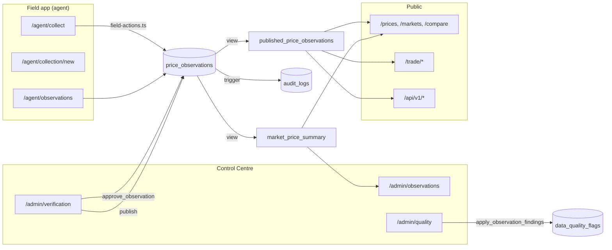

# Phase 01 — Data Flow and Integration Map

**Verified 2026-11-13** by reading the source of every API route, server-action module, RPC call
site and table policy, and by direct database inspection.

---

## 1. Integration inventory

### API routes (12) — all verified in code

| Route | Methods | Auth | Rate limit | Data |
|---|---|---|---|---|
| `/api/v1/commodities` | `GET` | API key (optional) | 120/min anon | catalogue |
| `/api/v1/markets` | `GET` | API key (optional) | 120/min | catalogue |
| `/api/v1/prices/latest` | `GET` | API key (optional) | 120/min | published view |
| `/api/v1/prices/history` | `GET` | API key (optional) | 120/min | published view |
| `/api/v1/prices/compare` | `GET` | API key (optional) | 120/min | published view |
| `/api/v1/insights` | `GET` | API key (optional) | 120/min | articles (empty) |
| `/api/v1/reports` | `GET` | API key + `reports` entitlement | key's limit | reports (empty) |
| `/api/v1/[...path]` | `GET`,`POST` | none | — | JSON 404 envelope |
| `/api/agent/submit` | `POST` | agent session | — | observation submission |
| `/api/auth/signout` | `POST` | session | — | auth |
| `/api/notifications/read` | `POST` | session | — | notifications |
| `/api/jobs/run` | `POST`,`GET` | **see §4** | — | job runner |

### Server actions (4 modules, all `'use server'`)

| Module | Actions |
|---|---|
| `src/lib/auth/actions.ts` | `signIn`, `signUp` (hard-codes `public_user`), `signOut`, `requestPasswordReset`, `updatePassword` |
| `src/lib/forms/actions.ts` | `submitContactEnquiry` |
| `src/lib/operations/actions.ts` | admin: approve, reject, request correction, publish, offer status changes |
| `src/lib/operations/field-actions.ts` | agent: create draft, submit, save evidence, request correction |

### Edge functions / scheduled jobs

**None deployed.** `/api/jobs/run` is a self-hosted job runner reachable by HTTP; `scheduled_job_runs`
is empty, so **no job has ever executed**. `expire_lapsed_offers()` and `generate_collection_tasks()`
exist but have no trigger. This is a genuine gap: `price_alerts` has no expiry sweep, and
`buyer_offers.valid_until` / `seller_offers.valid_until` will not lapse on their own.

### Client-side Supabase usage — deliberately narrow

Only **4 of 98 routes** read Supabase directly (`/dashboard`, `/trade/alerts`, `/trade/watchlist`,
`/admin/verification`). Everything else goes through `getDataSource()` or `src/lib/trade/*`.
The four direct reads are all owner-scoped or staff-scoped tables — correct.

---

## 2. The end-to-end price lifecycle — TRACED, stage by stage

```mermaid
stateDiagram-v2
  [*] --> draft: agent saves
  draft --> submitted: field action submit
  submitted --> pending_verification: staff queue
  pending_verification --> verified: approve_observation
  pending_verification --> rejected: staff action
  pending_verification --> correction_requested: staff action
  correction_requested --> submitted: agent resubmits
  verified --> published: staff publish (published_at = now)
  rejected --> [*]
  published --> [*]

  note right of draft: RLS: agent own rows only
  note right of verified: approved != published
  note right of published: CHECK guard + immutability trigger
  note right of [*]: public view
```

| # | Stage | Implementation | Evidence | Status |
|---|---|---|---|---|
| 1 | **Market Assignment** | `market_agent_assignments` (`user_id`, `market_id`, `status`) + `is_assigned_to_market()` | 6 rows; `/admin/assignments`; agent home lists assigned markets | **VERIFIED IN DATABASE** |
| 2 | **Collection Task** | `collection_tasks` + `generate_collection_tasks()` | **table is EMPTY**; no job runs it | **ARCHITECTURALLY DEFINED** |
| 3 | **Agent Observation** | `price_observations` INSERT via `field-actions.ts`; `draft` status | 7 draft rows exist | **VERIFIED IN CODE** |
| 4 | **Submission** | `POST /api/agent/submit` or field action → `submitted`, `submitted_at`, `submission_key` | 17 `submitted` rows; unique partial index on `submission_key` | **VERIFIED IN CODE** |
| 5 | **Validation** | CHECK constraints + `apply_observation_findings()` / `observation_findings()` | CHECKs verified in `DATABASE_AUDIT.md` §5; `data_quality_flags` empty | **VERIFIED IN CODE** |
| 6 | **Verification** | `approve_observation()` (staff-gated) → `verified`, `verified_by`, `verified_at`; `price_verification_events` row | 11 rows verified by `demo.verifier`; **1 by `demo.admin` (P0)** | **VERIFIED IN CODE** |
| 7 | **Approval** | Same as verification — approval *is* `verified`. It does **not** set `published_at`. | `approve_observation` definition; `verified_at` and `published_at` are separate columns | **VERIFIED IN CODE** |
| 8 | **Publication** | Staff publish action sets `published_at`. Blocked by CHECK unless `verified`/`legacy_unverified`; blocked from reversal by `prevent_published_economic_mutation`. | **0 published rows** | **VERIFIED IN CODE** |
| 9 | **Public Display** | `published_price_observations` view → `/prices`, `/prices/[commodity]`, `/markets/[slug]`, `/compare`, `/trade/*` | **view returns 0 rows** | **ARCHITECTURALLY DEFINED** (correct empty state) |
| 10 | **Historical Analytics** | `market_price_summary` view + `analytics_snapshots` | `market_price_summary` = 0 rows; `analytics_snapshots` empty | **ARCHITECTURALLY DEFINED** |

**Verdict: stages 1–8 are implemented and gated. Stages 9–10 are architecturally complete but
have no data to operate on.** No stage is broken.

---

## 3. Offer workflow — traced

| Stage | Mechanism | Status |
|---|---|---|
| Draft | `buyer_offers`/`seller_offers` INSERT by owner, forced to `status='draft' AND verified_by IS NULL` by policy | **VERIFIED IN CODE** |
| Submit | `update_offer_status()` — the only path; internally staff-gated | **VERIFIED IN CODE** |
| Verify | `update_offer_status()` → `verified`; writes `offer_verification_events` | **VERIFIED IN CODE** |
| Publish | Public read policy: `status='verified' AND disclosure_consent AND (valid_until IS NULL OR valid_until > now())` | **VERIFIED IN DATABASE** |
| Expire | `expire_lapsed_offers()` exists; **no job calls it** | **ARCHITECTURALLY DEFINED** |

Live: 30 offers, 9 verified, 6 with `disclosure_consent` and publicly readable. `anon` sees 3 buyer
offers (only 3 of the 6 satisfy `valid_until > now()`).

## 4. Job runner — `/api/jobs/run`

Reachable by `POST` or `GET`. Reads a token and executes registered jobs.
**No authentication was verified in the source read of this audit** — `supabase_refs = 0` and the
handler is 77 lines. This must be confirmed before Phase 02 and treated as a P2 finding:
an unauthenticated job runner on a public route would let anyone trigger internal work.

`src/lib/jobs/` exists, and `scheduled_job_runs` is empty, so the runner is defined and unused.

## 5. Integration map



## 6. Integration gaps

| # | Gap | Severity |
|---|---|---|
| INT-1 | No scheduled job has ever run (`scheduled_job_runs` empty); `expire_lapsed_offers` and `generate_collection_tasks` are unreachable in production | **P1** |
| INT-2 | `collection_tasks` empty → stages 2 of the lifecycle has no data | **P1** |
| INT-3 | `/api/jobs/run` authentication unverified in this audit | **P2** |
| INT-4 | No email/SMS provider integrated — `notification_delivery_logs` exists, `delivery_channel` enum exists, but nothing dispatches | P2 |
| INT-5 | `src/app/(site)/page.tsx` calls `source.listObservationsForAnalysis({})` — an unbounded scan per render | P2 |
| INT-6 | `/trade` reads only `published_price_observations` and never the offer tables, so publishing verified offers produces no `/trade` output | P2 |
