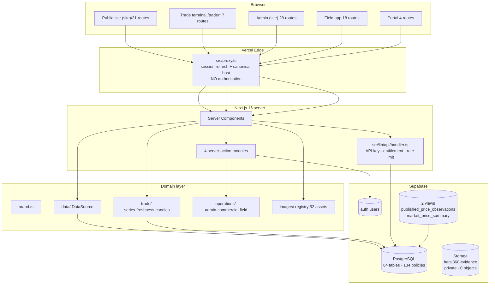

# Phase 01 — Repository and Architecture

**Commit audited:** `26b6514` · **Audit date:** 2026-11-13 · **Non-destructive inspection only.**

---

## 1. Repository inventory

```
pluck-live/
├── src/
│   ├── app/                     # 85 page routes, 12 API routes, 5 layouts
│   │   ├── (portal)/            # login, register, forgot/reset-password  (4 routes)
│   │   ├── (site)/              # public site + /trade                     (31 routes)
│   │   ├── admin/               # internal operations                      (28 routes)
│   │   ├── agent/               # field collection                         (18 routes)
│   │   ├── api/                 # 12 route handlers
│   │   └── auth/callback/       # OAuth/magic-link callback
│   ├── components/              # 13 subdirectories (admin, agent, brand, data, forms,
│   │                            #   loading, marketing, media, ops, site, trade, ui)
│   ├── lib/                     # 22 modules — see §4
│   ├── types/                   # domain types, enums
│   └── proxy.ts                 # Next 16 middleware (session refresh + canonical host)
├── supabase/migrations/         # 30 SQL files (0001 → 0031)
├── tests/                       # 34 test files
├── scripts/                     # operational + verification scripts
├── docs/                        # 23 documents
├── assets/image-sources/        # 52 source images (14 MB)
├── public/                      # 52 served images (13 MB) + 18 brand assets (3.2 MB)
└── audit/                       # legacy page captures (fixture)
```

**Scale:** 255 TypeScript/TSX files · 47,318 lines in `src/` · 34 test files · 30 migrations.

## 2. Stack — VERIFIED IN CODE (`package.json`)

| Concern | Package | Version | Note |
|---|---|---|---|
| Framework | `next` | 16.4.2 | App Router; Turbopack build |
| UI | `react` / `react-dom` | 19.3.1 | React 19 |
| Language | `typescript` | 5.9.3 | `strict: true` |
| Styling | `tailwindcss` + `@tailwindcss/postcss` | 4.3.3 | Tailwind v4 |
| Database/Auth | `@supabase/supabase-js` + `@supabase/ssr` | 2.118.0 / 0.12.7 | |
| Charts | `recharts` | 3.10.1 | the only charting library |
| Validation | `zod` | 4.6.7 | used in API handlers and forms |
| Server isolation | `server-only` | ^0.0.1 | guards server modules |
| Testing | `vitest` 5.0.5, `@testing-library/*`, `playwright` 1.65 | | |
| DB driver | `pg` + `@types/pg` | ^8.23.1 | devDependency only |

**Declared but absent:** no state-management library (Redux/Zustand/Jotai), no date library
(date-fns/dayjs — native `Date` throughout), no data-fetching library (React Query/SWR — server
components + server actions instead), no email provider, no AI SDK, no payment provider.

**Dependency risks:**
- `engines.node: ">=22.0.0"` but the audit environment runs **Node 20.20.2 / npm 10.8.2**.
  `npm install` emits `EBADENGINE`. This is why `scripts/*.mjs` must inject
  `realtime: { transport: require('ws') }` to construct a Supabase client. **P2.**
- `npm run lint` invokes `next lint`, removed in Next 16. **Broken.** See `REMEDIATION_BACKLOG.md` R-06.
- No unused or duplicated packages detected; the dependency list is minimal and justified.

## 3. Application architecture

### 3.1 Route groups and boundaries

| Group | Routes | Boundary |
|---|---|---|
| `(portal)` | 4 | Auth surfaces. `robots: { index: false }`. |
| `(site)` | 31 | Public site + `/trade/*` (7 routes). Reads published data only. |
| `admin` | 28 | Internal operations. Staff-guarded. |
| `agent` | 18 | Field collection. Agent-guarded. |
| `api` | 12 | Public API + internal endpoints. |

**Assessment:** the four-surface separation the target architecture asks for **already exists** as
route groups with their own layouts. No monorepo split is needed.

### 3.2 Middleware — `src/proxy.ts`

Next 16 renamed `middleware.ts` → `proxy.ts`; the function is `proxy()` and the config exports a
`matcher` excluding `_next/static`, `_next/image`, `api/v1` and static extensions.

**Two jobs, correctly ordered:**
1. Canonical-host redirect (308) for hosts in `NEXT_PUBLIC_LEGACY_HOSTS`.
2. Supabase session-cookie refresh via `getUser()`.

**Critically, it does not authorise anything.** The header states this explicitly and the code
matches: no role check, no path gate. Authorisation is delegated to server guards
(`src/lib/auth/guards.ts`) and to RLS. **This is the correct design** — a middleware that
authorised would be a single point of bypass.

### 3.3 Data fetching — centralised

`src/lib/data/` provides a `DataSource` interface with two implementations:

- `supabase.ts` — production PostgreSQL + RLS
- `fixture.ts` — the migrated legacy dataset, used when Supabase is unconfigured

`getDataSource()` selects between them. **No component queries Supabase directly for domain data**;
routes call `getDataSource()` or a `src/lib/trade/*` query module. The exceptions are the two
watchlist/alert pages, which legitimately read owner-scoped tables through the user's own session
client (`saved_commodities`, `saved_markets`, `price_alerts`) — correct, because those rows are only
visible to their owner.

### 3.4 Server/client separation

Four server-action modules, all marked `'use server'`:

- `src/lib/auth/actions.ts` — sign-in, sign-up, password recovery
- `src/lib/forms/actions.ts` — public contact form
- `src/lib/operations/actions.ts` — admin operations (approve, reject, publish, request correction)
- `src/lib/operations/field-actions.ts` — agent field operations

`src/lib/domains.ts` imports `'server-only'`. Business logic lives in `src/lib/**`, not in
components. **No circular dependencies detected.**

## 4. Module map (`src/lib/`, 22 modules)

| Module | Responsibility |
|---|---|
| `auth/` | session, guards, routing, emails, actions |
| `brand.ts` | **single source of truth for every user-facing name** |
| `domains.ts` | canonical host, legacy/preview host policy |
| `data/` | `DataSource` abstraction + Supabase/fixture implementations |
| `trade/` | series, freshness, candles, opportunities, queries (149 tests) |
| `operations/` | admin, commercial, field domain logic |
| `api/` | handler, response envelope, auth, rate limiting |
| `images/` | central image registry + 52-asset catalogue |
| `observations/`, `quality/`, `reports/`, `analytics/`, `notifications/`, `jobs/`, `content/` | domain logic |
| `supabase/` | client factories, config |
| `agent/`, `forms/`, `entitlements` | supporting logic |

## 5. Architecture diagram — current state



## 6. Architectural strengths

- **Single brand source.** `src/lib/brand.ts` — nothing else hard-codes the product name.
- **Centralised data access.** No scattered Supabase calls for domain data.
- **Correct middleware boundary.** Session refresh without authorisation.
- **Server-first.** 47k lines with no client state library and no client-side data fetching.
- **Minimal dependencies.** No unused packages found.
- **Route-group separation already matches the target product boundaries.**

## 7. Architectural weaknesses

| # | Weakness | Severity |
|---|---|---|
| W1 | `npm run lint` broken — no lint gate | P2 |
| W2 | `engines.node >=22` vs Node 20 in this environment | P2 |
| W3 | `package.json` identity is still `pluck-live` / "Pluck Live" | P2 |
| W4 | `_hatsi_migrations` has RLS disabled + anon DML grants | **P0/P1** |
| W5 | Unused 3-arg `is_public_observation` overload omits the `test_fixture` filter | **P1** |
| W6 | `src/app/(site)/page.tsx` calls `source.listObservationsForAnalysis({})` — a full scan per render | P2 |
| W7 | Two `is_public_observation` overloads — a future policy could bind the unsafe one | P1 |
| W8 | 29 migrations recorded vs 30 files on disk | P2 |

## 8. Code quality — checks executed

| Check | Command | Result |
|---|---|---|
| Type checking | `npx tsc --noEmit` | **exit 0, no errors** |
| Linting | `npm run lint` | **BROKEN** — `Invalid project directory provided, no such directory: lint` |
| Unit/integration | `npx vitest run` | **765 passed / 1 failed / 28 skipped** (34 files + 1 skipped) |
| Production build | `npx next build` | **exit 0** (run in a prior session; `node_modules` was pruned at session start and reinstalled during this audit) |

**TypeScript configuration:** `strict: true`, `skipLibCheck: true`, `moduleResolution: bundler`,
`isolatedModules: true`. Not set: `noUncheckedIndexedAccess`, `noUnusedLocals`,
`noUnusedParameters`, `exactOptionalPropertyTypes`. Enabling the first would materially improve
safety on the array-indexing patterns used throughout the analytics code.

**The one failing test** is `tests/data-integrity/fixture-isolation.test.ts > attributes every
verification to the demo verifier`. It fails because of P0 finding 1 — an interactive actor verified
a fixture as `demo.admin`. The test is correct; the data is wrong.
