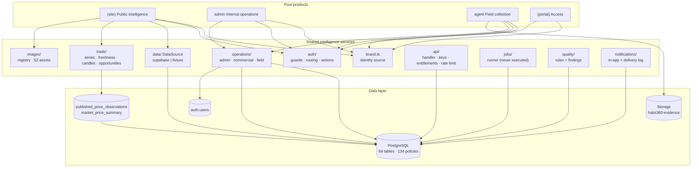
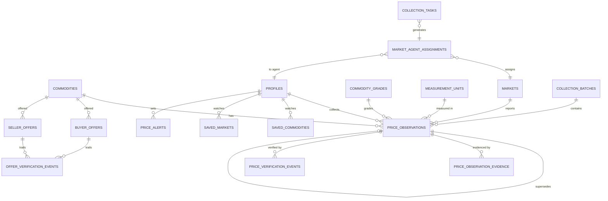
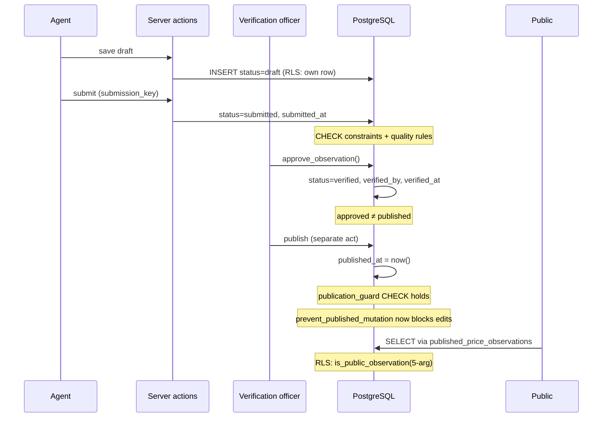

# Phase 01 — Target Architecture

> **PROPOSAL ONLY.** Nothing in this document has been implemented, approved, or scheduled.
> No schema, route, component or branding change has been made. This is the architecture
> Phase 02 would build *if* approved.

**Design constraint carried from the audit:** the application already has four route groups
(`(site)`, `admin`, `agent`, `(portal)`) and a centralised `DataSource`. The target is therefore an
**evolution, not a rebuild**. No monorepo split is required.

---

## 1. The four products

### 1.1 Public intelligence app — `(site)`

The free, public price-discovery product.

| Surface | Content | Source |
|---|---|---|
| Homepage | Honest snapshot, latest published prices by commodity | `published_price_observations` |
| `/markets`, `/markets/[slug]` | Market register + per-market commodity prices | same |
| `/commodities`, `/commodities/[slug]` | Commodity directory + grades, markets, series | same |
| `/prices`, `/prices/[commodity]` | Price directory + history | same |
| `/compare` | Cross-market comparison, **only where grade/unit/price type match** | same |
| `/trade/*` | Terminal, best-buy/best-sell, fundamentals, alerts, watchlist | + `buyer_offers`/`seller_offers` |
| `/methodology`, `/coverage-report`, `/api-docs`, `/api-policy` | Explain the data honestly | static |
| `/insights`, `/reports` | Research — **empty until data exists** | `articles`, `market_reports` |

**Rules that must hold:** only explicitly published rows are visible; an empty dataset renders an
honest empty state, never a placeholder or fabricated series; charts show freshness and observation
count; no map until coordinates are verified.

### 1.2 Internal operations app — `admin`

The Control Centre. 29 modules already exist. The target keeps them and makes the data real.

| Group | Modules | Change |
|---|---|---|
| Catalogue | markets, commodities, categories, grades, units, zones | keep; zones needs data |
| Collection | assignments, schedule, tasks, agents | **needs `collection_tasks` populated** |
| Verification | verification, observations, quality | keep; quality needs `data_quality_flags` |
| Publication | *(within verification)* | **explicit separate publish act** |
| Commercial | customers, subscriptions, offers | needs `customer_subscriptions` data |
| Intelligence | analytics, reports | needs `analytics_snapshots` data |
| Platform | exports, notifications, api-management, audit, system, settings, search, profile | needs `api_applications` data |

**Admin may remain data-dense.** No decorative reduction.

### 1.3 Field collection app — `agent`

19 routes exist. **Must stay simple, touch-friendly and low-bandwidth.**

| Surface | Purpose |
|---|---|
| `/agent/home` | Today's assignments and status |
| `/agent/assignments`, `/agent/assignments/[id]` | Assigned markets |
| `/agent/collect`, `/agent/collection/new` | Start a session |
| `/agent/collection/[id]` | Capture observations |
| `/agent/observations`, `/agent/observations/[id]` | Own observations |
| `/agent/corrections` | Correction requests |
| `/agent/markets`, `/agent/markets/[id]` | Reference for assigned markets |
| `/agent/submissions`, `/agent/tasks`, `/agent/history` | Status |
| `/agent/performance`, `/agent/profile`, `/agent/notifications`, `/agent/help` | Support |

**Offline capability is PLANNED, not present.** If Phase 02 builds it, it must be idempotent
(`submission_key` already supports this), conflict-aware, private, and must never claim "submitted"
before the server confirms.

### 1.4 Portal — `(portal)`

Login, register, password recovery. **The demo-accounts panel is a P0 finding** — see R-01.

---

## 2. Shared intelligence services

All shared services already exist as modules under `src/lib/`. **The target architecture is a
completion of this structure, not a replacement.**

---

## 3. Target data architecture

### 3.1 Preserved unchanged

`price_observations` (all 33 columns, both self-FKs, the duplicate guard, the publication guard, the
immutability trigger) · `market_price_summary` · `published_price_observations` ·
`commodity_grades` · `measurement_units` · `price_source_registry` · `buyer_offers`/`seller_offers` ·
`offer_verification_events` · `market_agent_assignments` · the full RLS policy set.

### 3.2 Must be populated before the corresponding feature ships

| Table | Blocks | Note |
|---|---|---|
| `collection_tasks` | `/admin/tasks`, `/agent/tasks`, lifecycle stage 2 | |
| `market_zones` | `/admin/zones`, zone analytics | |
| `markets.latitude/longitude` | any map | **verified source only** |
| `commodity_unit_conversions` | cross-unit comparison | |
| `data_quality_flags` | `/admin/quality` | |
| `commodity_fundamentals` | `/trade/fundamentals` | |
| `commodity_seasonality` | seasonality charts | |
| `commodity_specifications` | commodity profiles | |
| `articles`, `market_reports` | `/insights`, `/reports` | |
| `analytics_snapshots` | `/admin/analytics`, historical analytics | |
| `api_applications` | `/admin/api-management` | |
| `customer_subscriptions` | `/admin/subscriptions` | |
| `export_jobs` | `/admin/exports` | |

### 3.3 Must be built

| Component | Why |
|---|---|
| A job scheduler | `scheduled_job_runs` empty; `expire_lapsed_offers` and `generate_collection_tasks` unreachable |
| An email/SMS provider | `alert_delivery_logs` empty; `delivery_channel` enum unused |
| Offer → `/trade` integration | `/trade` never reads the offer tables (INT-6) |
| Offline capture + sync queue | offline capability is PLANNED |

### 3.4 Target domain model

---

## 4. Target security posture

Preserved from the audit: 134 RLS policies · the publication CHECK · the immutability trigger ·
append-only corrections · `search_path` pinning on every definer function · no service-role key in
the browser · middleware that refreshes but never authorises.

Added in the target:
- RLS on `_hatsi_migrations`, no `anon` DML (R-02)
- The 3-arg `is_public_observation` overload removed (R-04)
- `ip_hash` captured on every privileged action (R-10)
- Demo accounts gated off by default in production (R-01)
- `contact_enquiries` rate-limited (R-17)

## 5. Target publication lifecycle

**Two deliberate acts remain two deliberate acts.** Verification and publication are never merged.

## 6. What the target explicitly does NOT include

- No page redesign, brand change or component rewrite (audit scope).
- No map before verified coordinates exist.
- No intraday candlesticks from daily observations.
- No forecast without an explicit model, method and limitations.
- No AI-generated research published without verification.
- No payment provider — "premium" gating is limited to entitlements that actually exist.
- No production deployment, DNS change, or migration without a staged test and rollback plan.
