# Phase 07 — Dependency Map

**Phase:** 07 — Global Trade Intelligence  
**Date:** 2026-01-XX  
**Status:** Stage 1 Complete

---

## Executive Summary

This document maps the dependencies between Phase 07 and all previous phases (00-06), identifies what can be reused, what must be extended, and what must be built from scratch. It also identifies external dependencies (data sources, infrastructure, etc.) that Phase 07 requires.

---

## 1. Phase Dependencies Overview

```mermaid
graph TD
    P00[Phase 00: Production Safety] --> P01
    P01[Phase 01: Market Data] --> P02
    P01 --> P03
    P02[Phase 02: Terminal UI] --> P06
    P03[Phase 03: Commodity Intelligence] --> P06
    P04[Phase 04: Marketplace] --> P05
    P04 --> P07
    P05[Phase 05: Business Workspace] --> P07
    P06[Phase 06: Intelligence & AI] --> P07
    P07[Phase 07: Global Trade Intelligence]
    
    style P07 fill:#1D805A,stroke:#103C2D,stroke-width:3px
    style P06 fill:#103C2D,stroke:#C7A45A,stroke-width:2px
```



---

## 2. Detailed Phase Dependencies

### 2.1 Phase 00 — Production Safety and Technical Stabilisation

**Status:** ✅ COMPLETE  
**Dependency Type:** FOUNDATIONAL

**What Phase 07 Can Reuse:**

| Component | Reuse Type | Notes |
|-----------|------------|-------|
| Database schema foundation | ✅ Direct reuse | Tables, indexes, constraints |
| RLS policy patterns | ✅ Direct reuse | Security patterns for trade data |
| Authentication system | ✅ Direct reuse | Supabase Auth operational |
| Role-based access control | ⚠️ Extend | Add trade analyst roles |
| Audit logging | ✅ Direct reuse | Track trade data changes |
| Quality rules engine | ⚠️ Adapt | Apply to trade data validation |
| Test infrastructure | ✅ Direct reuse | Vitest setup, test patterns |

**What Phase 07 Must Build:**
- Trade data quality rules (HS code validation, trade flow checks)
- Trade-specific audit logging (data source changes, regulatory updates)

**Dependency Risk:** LOW  
**Mitigation:** None required — Phase 00 is solid foundation

---

### 2.2 Phase 01 — Market Data Activation

**Status:** ✅ COMPLETE  
**Dependency Type:** PATTERN REFERENCE

**What Phase 07 Can Reuse:**

| Component | Reuse Type | Notes |
|-----------|------------|-------|
| Data ingestion pipeline | ⚠️ Adapt | Similar pattern for trade data |
| Verification workflow | ⚠️ Adapt | Apply to trade data validation |
| Analytics views | ⚠️ Adapt | Similar aggregation patterns |
| Quality checks | ⚠️ Adapt | Trade-specific validation rules |

**What Phase 07 Must Build:**
- International trade data ingestion (different sources, different schema)
- HS code mapping during ingestion
- Multi-country data handling
- Trade flow validation

**Dependency Risk:** LOW  
**Mitigation:** None required — patterns can be adapted

---

### 2.3 Phase 02 — Market Terminal and Visualization

**Status:** ✅ COMPLETE  
**Dependency Type:** UI/UX FOUNDATION

**What Phase 07 Can Reuse:**

| Component | Reuse Type | Notes |
|-----------|------------|-------|
| Design system | ✅ Direct reuse | Tokens, colors, typography |
| Component library | ⚠️ Extend | Add trade-specific components |
| Chart components | ⚠️ Extend | Add trade flow charts, maps |
| Responsive patterns | ✅ Direct reuse | Mobile/tablet/desktop layouts |
| Data table components | ⚠️ Extend | Add trade data tables |

**What Phase 07 Must Build:**
- Trade flow explorer UI
- Country/commodity profile pages
- Geographic map components
- Tariff/regulatory display components
- Export readiness checklist UI

**Dependency Risk:** LOW  
**Mitigation:** None required — design system is solid

---

### 2.4 Phase 03 — Commodity Intelligence

**Status:** ⚠️ AUDIT ONLY  
**Dependency Type:** REQUIREMENTS REFERENCE

**What Phase 07 Can Reuse:**

| Component | Reuse Type | Notes |
|-----------|------------|-------|
| Requirements documentation | ✅ Direct reuse | Informs trade intelligence design |
| Data source research | ⚠️ Extend | Add international trade sources |

**What Phase 07 Must Build:**
- All trade intelligence features (Phase 03 not implemented)

**Dependency Risk:** LOW  
**Mitigation:** None required — audit provides good reference

---

### 2.5 Phase 04 — Trade Marketplace

**Status:** ⚠️ AUDIT ONLY  
**Dependency Type:** INTEGRATION TARGET

**What Phase 07 Can Reuse:**

| Component | Reuse Type | Notes |
|-----------|------------|-------|
| Offer schema | ⚠️ Extend | Add trade opportunity fields |
| Verification events | ⚠️ Extend | Track trade opportunity verification |

**What Phase 07 Must Build:**
- Connection between trade intelligence and marketplace
- Trade opportunity discovery from intelligence data
- Buyer/seller matching based on trade flows

**Dependency Risk:** MEDIUM  
**Mitigation:** Phase 04 must be implemented before Phase 07 integration (Stage 9)

**Critical Path:**
```
Phase 04 Implementation → Phase 07 Stage 9 (Integration)
```

---

### 2.6 Phase 05 — Business Workspace

**Status:** ⚠️ AUDIT ONLY  
**Dependency Type:** INTEGRATION TARGET

**What Phase 07 Can Reuse:**

| Component | Reuse Type | Notes |
|-----------|------------|-------|
| Organization model | ⚠️ Extend | Add trade workspace features |
| Member management | ✅ Direct reuse | Team collaboration on trade research |

**What Phase 07 Must Build:**
- Organization-scoped trade research
- Team collaboration on export readiness
- Private trade intelligence workspace

**Dependency Risk:** MEDIUM  
**Mitigation:** Phase 05 must be implemented before Phase 07 integration (Stage 9)

**Critical Path:**
```
Phase 05 Implementation → Phase 07 Stage 9 (Integration)
```

---

### 2.7 Phase 06 — Commodity Intelligence and AI Analyst

**Status:** ✅ STAGES 1-4 COMPLETE  
**Dependency Type:** CRITICAL DEPENDENCY

**What Phase 07 Can Reuse:**

| Component | Reuse Type | Notes |
|-----------|------------|-------|
| Intelligence service architecture | ⚠️ Extend | Add trade intelligence methods |
| Ingestion framework | ⚠️ Extend | Add trade data source adapters |
| Evidence provenance system | ✅ Direct reuse | Track trade data sources |
| Source registry | ⚠️ Extend | Add international trade sources |
| Analytical view patterns | ⚠️ Extend | Add trade flow analytics |
| UI components | ⚠️ Extend | Add trade-specific visualizations |
| Chart components | ⚠️ Extend | Add trade flow charts |

**What Phase 07 Must Build:**
- Trade data ingestion adapters (UN Comtrade, ITC, WTO, etc.)
- HS classification system
- Multi-country trade analytics
- Market access/regulatory infrastructure
- Tariff schedule system
- Trade agreement database
- Export readiness workflow
- AI analyst extension for trade intelligence

**Dependency Risk:** LOW  
**Mitigation:** None required — Phase 06 provides excellent foundation

**Critical Path:**
```
Phase 06 (Complete) → Phase 07 Stage 2+ (Build on foundation)
```

---

## 3. External Dependencies

### 3.1 Data Sources

| Source | Priority | Access Method | Cost | Status | Risk |
|--------|----------|---------------|------|--------|------|
| ITC Trade Map | **CRITICAL** | Free registration | Free | ❌ Not started | LOW |
| FAOSTAT (trade data) | **HIGH** | API | Free | ⚠️ Extend existing | LOW |
| WTO Tariffs | **HIGH** | Free | Free | ❌ Not started | LOW |
| WITS | **MEDIUM** | Free | Free | ❌ Not started | LOW |
| UN Comtrade | **HIGH** | API subscription | $5K-20K/year | ❌ Not started | MEDIUM |
| UNCTAD TRAINS | **MEDIUM** | Free | Free | ❌ Not started | LOW |
| AfCFTA Data | **HIGH** | Restricted | Varies | ❌ Not started | HIGH |

**Dependency Risk:** MEDIUM  
**Mitigation:**
- Start with free sources (ITC Trade Map, WTO, WITS)
- Evaluate UN Comtrade based on budget
- Build abstraction layer for multiple sources

### 3.2 Infrastructure

| Service | Requirement | Current State | Action Needed | Risk |
|---------|-------------|---------------|---------------|------|
| Supabase | Database | ✅ Operational | May need plan upgrade | LOW |
| Vercel | Hosting | ✅ Operational | No changes needed | LOW |
| Edge Functions | Data sync | ✅ Available | Extend for trade data | LOW |
| Storage | Raw data files | ⚠️ Limited | May need expansion | LOW |

**Dependency Risk:** LOW  
**Mitigation:** Current infrastructure sufficient for Phase 07

### 3.3 Third-Party Services

| Service | Purpose | Cost | Status | Risk |
|---------|---------|------|--------|------|
| Recharts | Charts | Free | ✅ Installed | LOW |
| Map libraries | Geographic viz | Free/Paid | ❌ Not installed | LOW |
| PDF generation | Report export | Free/Paid | ❌ Not installed | LOW |

**Dependency Risk:** LOW  
**Mitigation:** Evaluate open-source options first

---

## 4. Internal Dependencies

### 4.1 Database Dependencies

**Phase 07 requires new tables:**

| Table | Depends On | Purpose |
|-------|-----------|---------|
| `hs_codes` | None | HS classification system |
| `hs_revisions` | None | HS nomenclature versions |
| `commodity_hs_mappings` | `commodities`, `hs_codes` | Map commodities to HS codes |
| `trade_blocs` | None | Trade agreements (AfCFTA, ECOWAS, etc.) |
| `trade_bloc_memberships` | `countries`, `trade_blocs` | Country memberships |
| `international_trade_records` | `countries`, `commodities`, `hs_codes` | Core trade data |
| `tariff_schedules` | `countries`, `hs_codes` | Tariff rates |
| `market_access_requirements` | `countries`, `commodities` | Regulatory requirements |
| `trade_agreements` | None | Agreement details |
| `export_readiness_assessments` | `organizations`, `countries`, `commodities` | Readiness workflows |

**Dependency Risk:** LOW  
**Mitigation:** Standard database design patterns

### 4.2 API Dependencies

**Phase 07 requires new API routes:**

| Route | Depends On | Purpose |
|-------|-----------|---------|
| `/api/v1/trade/*` | Trade data tables | Trade data queries |
| `/api/v1/hs-codes/*` | HS classification | HS code lookup |
| `/api/v1/market-access/*` | Regulatory tables | Market access info |
| `/api/v1/tariffs/*` | Tariff tables | Tariff lookup |
| `/api/v1/export-readiness/*` | Readiness tables | Export workflows |

**Dependency Risk:** LOW  
**Mitigation:** Follow existing API patterns

### 4.3 Component Dependencies

**Phase 07 requires new UI components:**

| Component | Depends On | Purpose |
|-----------|-----------|---------|
| Country profile | Country data, trade data | Display country trade info |
| Commodity trade profile | Commodity data, HS codes | Display commodity trade info |
| Trade flow explorer | Trade data, filters | Interactive trade exploration |
| Geographic map | Country coordinates | Visualize trade flows |
| Tariff display | Tariff data | Show tariff rates |
| Export readiness checklist | Readiness data | Interactive checklist |

**Dependency Risk:** LOW  
**Mitigation:** Extend existing component library

---

## 5. Critical Path Analysis

### 5.1 Phase 07 Critical Path

```
Week 1-4: Geographic & Classification Foundation
  ├─ Countries table expansion (200+ countries)
  ├─ HS classification system
  └─ Trade bloc database

Week 5-10: Trade Data Engine
  ├─ ITC Trade Map integration
  ├─ FAOSTAT trade data extension
  └─ WTO tariff data integration

Week 11-16: Trade Intelligence Analytics
  ├─ Country trade profiles
  ├─ Commodity trade profiles
  └─ Trade flow explorer

Week 17-26: Market Access & Discovery
  ├─ Destination market discovery
  ├─ Market access requirements
  └─ Tariff intelligence

Week 27-38: Export Readiness & Integration
  ├─ Export readiness workflows
  ├─ Phase 04/05 integration
  └─ Trade corridor intelligence

Week 39-52: AI, Commercialization & Production
  ├─ AI analyst extension
  ├─ Entitlement integration
  └─ Production readiness
```

### 5.2 External Critical Paths

**Path 1: Data Source Access**
```
Week 1: Register for ITC Trade Map
Week 2-4: Test access, understand API
Week 5-8: Build ingestion adapter
Week 9-10: Validate data, go live
```

**Path 2: UN Comtrade Decision**
```
Week 1: Evaluate requirements
Week 2: Budget approval (if needed)
Week 3-4: Subscription setup
Week 5-8: Build ingestion adapter
Week 9-10: Validate data, go live
```

**Path 3: Phase 04/05 Integration**
```
Phase 04 Implementation (3-6 months)
  ↓
Phase 05 Implementation (3-4 months)
  ↓
Phase 07 Stage 9: Integration (4 weeks)
```

---

## 6. Dependency Risk Matrix

| Dependency | Probability | Impact | Risk Level | Mitigation |
|------------|-------------|--------|------------|------------|
| UN Comtrade access denied | LOW | HIGH | MEDIUM | Use free sources (ITC, WTO, WITS) |
| UN Comtrade budget not approved | MEDIUM | MEDIUM | MEDIUM | Phase with free sources first |
| ITC Trade Map API changes | LOW | MEDIUM | LOW | Build abstraction layer |
| Phase 04 delayed | MEDIUM | HIGH | MEDIUM | Decouple Phase 07 from Phase 04 |
| Phase 05 delayed | MEDIUM | HIGH | MEDIUM | Decouple Phase 07 from Phase 05 |
| HS classification complexity | HIGH | MEDIUM | MEDIUM | Start with major commodities |
| Large trade data volume | MEDIUM | MEDIUM | MEDIUM | Use materialized views, indexing |
| Data licensing restrictions | LOW | HIGH | MEDIUM | Track licensing per source |

---

## 7. Dependency Resolution Plan

### 7.1 Immediate Actions (Week 1-2)

1. ✅ Complete Phase 07 baseline audit
2. ⏳ Register for ITC Trade Map access
3. ⏳ Evaluate UN Comtrade requirements
4. ⏳ Begin HS classification research
5. ⏳ Design geographic data expansion

### 7.2 Short-Term Actions (Week 3-8)

1. ⏳ Expand countries table
2. ⏳ Build HS classification system
3. ⏳ Integrate ITC Trade Map data
4. ⏳ Extend FAOSTAT for trade data
5. ⏳ Integrate WTO tariff data

### 7.3 Medium-Term Actions (Week 9-20)

1. ⏳ Build trade intelligence analytics
2. ⏳ Build market access infrastructure
3. ⏳ Build tariff schedule system
4. ⏳ Monitor Phase 04/05 progress
5. ⏳ Prepare for integration (Stage 9)

### 7.4 Long-Term Actions (Week 21-52)

1. ⏳ Complete export readiness workflows
2. ⏳ Integrate with Phase 04/05 (when ready)
3. ⏳ Extend AI analyst for trade intelligence
4. ⏳ Production readiness and deployment

---

## 8. Dependency Monitoring

### 8.1 Key Metrics

| Metric | Target | Current | Status |
|--------|--------|---------|--------|
| Countries in database | 200+ | 1 | ❌ Not started |
| HS codes in database | 5,000+ | 0 | ❌ Not started |
| Trade data sources integrated | 3+ | 0 | ❌ Not started |
| Trade records in database | 100,000+ | 22 | ❌ Not started |
| Phase 04 implementation status | Complete | Audit only | ⚠️ Not started |
| Phase 05 implementation status | Complete | Audit only | ⚠️ Not started |

### 8.2 Dependency Tracking

**Weekly Review:**
- Data source access status
- Phase 04/05 implementation progress
- HS classification coverage
- Trade data volume and quality

**Monthly Review:**
- Budget status (UN Comtrade decision)
- Infrastructure capacity
- Performance metrics
- Risk assessment update

---

## 9. Conclusion

Phase 07 has **strong dependencies on Phase 06** (which is complete and provides an excellent foundation) and **medium dependencies on Phases 04 and 05** (which are audit-only and must be implemented before integration).

**Key Takeaways:**

1. ✅ Phase 06 provides solid foundation — can be extended for trade intelligence
2. ⚠️ Phases 04/05 are not implemented — integration delayed until they're ready
3. ❌ Geographic data must be expanded — critical gap (1 country → 200+ countries)
4. ❌ HS classification system must be built — critical gap (no HS codes)
5. ❌ International trade data sources must be integrated — critical gap (no trade data)

**Recommendation:**

Proceed with Phase 07 implementation in parallel with Phase 04/05 implementation. Phase 07 Stages 2-8 can proceed independently. Stage 9 (integration) will wait for Phases 04/05 completion.

**Critical Path:**
```
Phase 07 Stages 2-8 (Independent) → Phase 04/05 Implementation → Phase 07 Stage 9 (Integration)
```

---

**Document Version:** 1.0  
**Last Updated:** 2026-01-XX  
**Next Review:** Weekly during implementation
